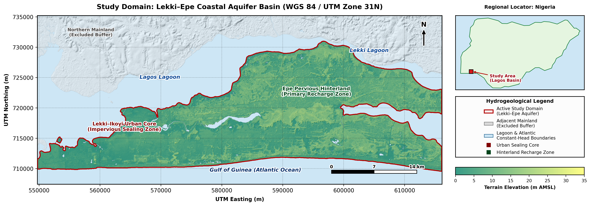
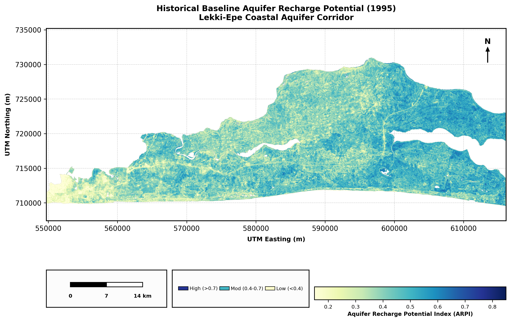
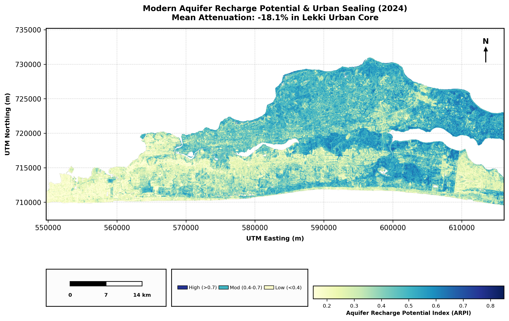
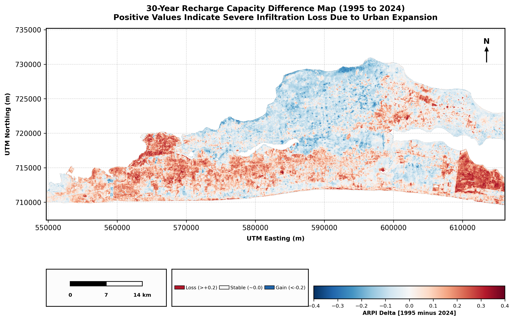
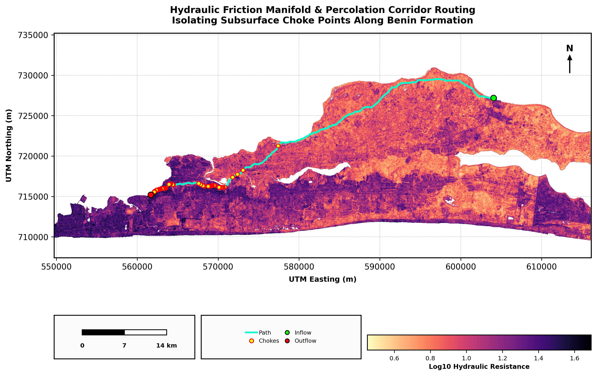
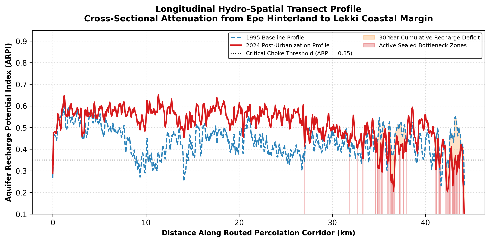

# Coastal Hydrogeology & Subsurface Connectivity Modeling

**Author:** David Oloyede  
**Research Focus:** Coastal Zone Dynamics, Physical Hydrogeology & Global Change  

---

## Overview
This repository contains a reproducible computational pipeline that quantifies 30-year groundwater recharge attenuation (1995–2024) and subsurface percolation impedance across the Lekki-Epe coastal aquifer corridor in Lagos, Nigeria. Rapid demographic and infrastructural expansion along the Gulf of Guinea margin has driven widespread replacement of permeable coastal sands and wetland vegetation with impervious concrete. This land-surface sealing disrupts natural infiltration pathways, accelerates surface runoff, starves shallow unconfined groundwater reserves, and heightens vulnerability to saltwater intrusion from the Atlantic Ocean and the Lagos-Lekki lagoon system.

To overcome the chronic scarcity of long-term piezometric gauge networks in the basin, this study engineers an end-to-end cloud-to-numerical workflow. Using Google Earth Engine (GEE) and scientific Python libraries, the pipeline harmonizes multi-decadal optical satellite records (Landsat-5 TM and Sentinel-2 MSI), conditions 30m digital elevation data via a 2D Laplacian operator to model surface convergence, synthesizes a physics-informed Aquifer Recharge Potential Index (ARPI), executes graph-theoretical Dijkstra routing to isolate subsurface flow bottlenecks, and compiles spatially distributed Effective Areal Recharge arrays (mm/yr) directly into a MODFLOW 6 numerical framework via FloPy.

## Complete Portfolio Documentation
* **Full Written Mini-Study & Spatial Analysis:** [View Complete PDF](documents/Lekki_Coastal_Aquifer_Recharge_Report.pdf)

## Module-by-Module Code Execution
* **Cloud Harmonization, ARPI Synthesis, Dijkstra Percolation Routing & MODFLOW 6 / FloPy Export:** [Open Colab Notebook](https://colab.research.google.com/drive/11YyjwtvWrfmiFU0lYvBRQe6YMzfSbmId) | [View Source Notebook](code/Lekki_Hydro_Study.ipynb)

---

## Visual Synthesis

| Study Domain & Physiographic Baseline |
| :---: |
|  |
| **Physiographic Setting:** Delineation of the unconfined coastal aquifer study domain across the Lekki-Epe peninsula (UTM Zone 31N), bounded by the Lagos Lagoon to the north, the Lekki Lagoon to the east, and the Atlantic Ocean to the south, illustrating the structural transition from the densely urbanized western core to the pervious Epe hinterland. |

| Historical Baseline ARPI (1995) | Modern Post-Urbanization ARPI (2024) |
| :---: | :---: |
|  |  |
| **1995 Pre-Expansion Baseline:** Widespread high-to-moderate recharge capacity sustained across natural coastal sandy ridges, barrier islands, and undisturbed swamp forest corridors prior to intensive metropolitan expansion. | **2024 Modern State:** Severe contraction of active infiltration zones across the western Lekki-Ikoyi urban core, showing an 18.1% whole-basin ARPI reduction and localized urban attenuation exceeding 45% due to impervious surface sealing. |

| 30-Year Recharge Capacity Difference (1995–2024) | Hydraulic Friction Manifold & Percolation Routing |
| :---: | :---: |
|  |  |
| **Differential Infiltration Loss:** Pixel-wise 30-year temporal delta (1995 - 2024) isolating contiguous zones of acute anthropogenic recharge loss ($> +0.20$, red) along primary highway and real-estate development axes, contrasted against stable rural recharge zones in blue. | **Least-Cost Subsurface Connectivity:** Graph-theoretical 8-connected Dijkstra path routed across the log-transformed hydraulic resistance manifold ($\log_{10} R$), tracing the primary percolation corridor from the Epe inflow source to the Lekki coastal outlet and flagging critical urban choke points ($\text{ARPI} < 0.35$). |

| Longitudinal Hydro-Spatial Transect Profile |
| :---: |
|  |
| **Cross-Sectional Attenuation:** Longitudinal profile extracted along the routed percolation corridor from the Epe hinterland to the Lekki coastal margin, contrasting the 1995 baseline against the 2024 post-urbanization profile and highlighting the 30-year cumulative recharge deficit and active sealed bottleneck zones below the critical $\text{ARPI} = 0.35$ threshold. |

---

## Methodological Architecture & Technical Stack

| Stage | Analytical Module | Mathematical & Spatial Operations | Technical Stack |
| :--- | :--- | :--- | :--- |
| **01** | **Cloud Ingestion & Cross-Sensor Harmonization** | Multi-temporal surface reflectance ingestion from Landsat-5 TM (1995 baseline) and Sentinel-2 MSI (2024 modern state); empirical radiometric shift calibration anchored across undisturbed rural reference polygons in the eastern Epe sector to remove sensor bandpass bias; derivation of Normalized Difference Built-up Index ($\text{NDBI}$) and Vegetation Index ($\text{NDVI}$). | `Google Earth Engine API`, `Python` |
| **02** | **Topographic Conditioning & ARPI Synthesis** | Gaussian kernel smoothing ($\sigma = 1.5$) on a 30m Digital Elevation Model (DEM); omnidirectional 2D Laplacian operator ($-\nabla^2 z$) to quantify local topographic convergence and depression storage; adjusted Topographic Wetness Index ($\text{TWI}$) derivation; multi-criteria weighted linear combination integrating surface permeability ($1 - \text{NDBI}$), terrain slope, $\text{TWI}$, CHIRPS precipitation, and $\text{NDVI}$. | `NumPy`, `SciPy (ndimage)`, `Rasterio` |
| **03** | **Graph-Theoretical Percolation Routing** | Non-linear exponential transformation of the modern recharge surface into an isotropic hydraulic resistance manifold ($R = \exp[4(1 - \text{ARPI}_{2024})]$); construction of an 8-connected pixel adjacency graph; execution of Dijkstra's minimum-cost path algorithm from the Epe recharge hinterland to the Lekki discharge margin; automated extraction of longitudinal profiles and urban sealing choke nodes ($\text{ARPI} < 0.35$). | `scikit-image (graph)`, `GeoPandas`, `Shapely` |
| **04** | **Numerical Coupling & Cartographic Synthesis** | Conversion of unitless 30m ARPI arrays into physical Effective Areal Recharge grids ($\text{mm/yr}$) scaled by historical CHIRPS rainfall totals and specific yield parametrization for sandy coastal formations; programmatic generation of MODFLOW 6 Simulation (`MFSimulation`), Spatial Discretization (`ModflowGwfdis`), and Recharge (`ModflowGwfrch`) packages; 300 DPI cartographic output generation. | `FloPy (MODFLOW 6)`, `Matplotlib` |

---

## Key Empirical Findings
* **Basin-Wide Recharge Attenuation:** Across the entire Lekki-Epe corridor, mean recharge capacity declined by **18.1%** between 1995 and 2024 as built-up infrastructure expanded eastward along the peninsula.
* **Urban Core Impervious Sealing:** Within the high-density Lekki-Ikoyi urban sector, mean recharge potential dropped by **>45%**, transforming formerly permeable barrier-island sand ridges into high-runoff impervious surfaces.
* **Subsurface Percolation Bottlenecks:** Least-cost routing along the Benin Formation gradient demonstrates that while the eastern Epe hinterland remains an active recharge source, lateral and vertical percolation toward the western coastal margin is increasingly pinched by contiguous urban choke zones falling below the $\text{ARPI} = 0.35$ threshold.
* **Direct Numerical Model Readiness:** Scaling the 2024 ARPI surface against CHIRPS precipitation yields a spatially explicit 30m recharge boundary array ingested directly into `ModflowGwfrch`, eliminating the need for uniform recharge assumptions in coastal groundwater head and saltwater-intrusion simulations.

---

## Research Reflection
In rapidly urbanizing West African coastal megacities, groundwater depletion and saline intrusion along the land-ocean boundary are frequently approached purely from the perspective of over-abstraction, overlooking how aggressive surface sealing starves shallow unconfined aquifers from above. Because continuous in-situ piezometric monitoring across the Lagos coastal basin remains sparse, open-source satellite Earth Observation provides a vital observational bridge. By coupling multi-decadal spectral harmonization and terrain physics with graph-theoretical routing and MODFLOW 6 package compilation, this work demonstrates how reproducible geospatial workflows can convert raw orbital telemetry into physical boundary constraints for coastal water resource management.

